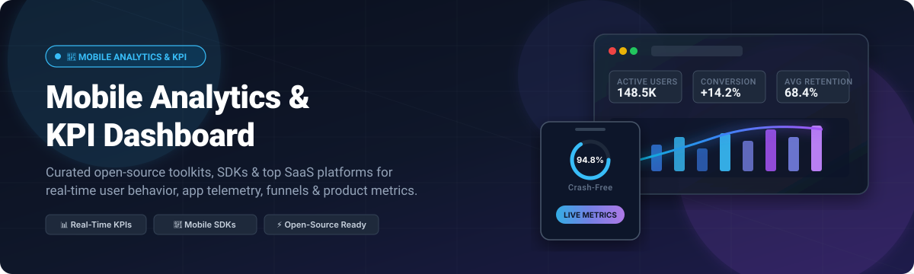

  

# 📱 Awesome Mobile Analytics & KPI Dashboard 📊

  
  
  
  
  
  

> 🌟 **A definitive, SEO-optimized curated directory of Mobile Analytics platforms, KPI Dashboards, Real User Monitoring (RUM) tools, and Telemetry SDKs** — featuring both enterprise SaaS solutions and battle-tested open-source software for monitoring user journeys, funnels, retention, crash analytics, and core app metrics.

---

## 📑 Table of Contents

- [🌐 Sector Overview & Market Dynamics](#-sector-overview--market-dynamics)
- [☁️ SaaS / Hosted Commercial Platforms](#️-saas--hosted-commercial-platforms)
- [🔓 Open-Source Software & Telemetry Frameworks](#-open-source-software--telemetry-frameworks)
- [📊 Feature & Architectural Matrix](#-feature--architectural-matrix)
- [📈 Star History](#-star-history)
- [🤝 Contributing & Community](#-contributing--community)
- [💖 Support & Sponsorship](#-support--sponsorship)
- [📄 License](#-license)

---

## 🌐 Sector Overview & Market Dynamics

The global mobile analytics market is valued between **$8 billion and $14 billion** and is projected to expand at a compound annual growth rate (**CAGR of 16%–25%**) toward upwards of **$35 billion to $80 billion** over the next decade. The sector exhibits **moderate fragmentation** — balancing dominant cloud hyper-scalers (Google Firebase, Datadog, Adobe) with a thriving, highly competitive ecosystem of specialized product analytics and mobile experience platforms (such as Mixpanel, Amplitude, and UXCam) rather than operating as a pure "winner-take-all" monopoly.

---

## ☁️ SaaS / Hosted Commercial Platforms

Commercial, cloud-hosted Mobile Analytics and KPI Dashboard suites. Sorted descending by company valuation / market capitalization:

| Platform 🚀 | Primary Focus & Capabilities 🎯 | Starting Tier Price 💳 | Free Tier / Trial Allowance 🎁 | Company Scale (Valuation / Revenue) 🏢 |
|---|---|---|---|---|
| **[Datadog Mobile RUM](https://www.datadoghq.com/)** | Full-stack Real User Monitoring correlating frontend mobile app telemetry directly with APM distributed traces | **$0.15 per 1,000 sessions** (RUM Measure annual commitment) | **14-day free trial** with full platform capabilities, unrestricted session replay & APM tracing | **~$50B Market Cap** ($3.43B FY2025 Revenue) |
| **[Zoho Apptics](https://www.zoho.com/apptics/)** | End-to-end privacy-focused mobile analytics suite with native iOS monitoring app, crash tracking & AI summaries | **$89 / month** billed monthly ($62 / month billed annually for Pro Tier) | **Free Forever plan**: 1 project, 5 apps, 5,000 errors/month, 25,000 tracked events & screen visits/month | **~$12B Estimated Valuation** ($1.4B+ Revenue) |
| **[Amplitude](https://amplitude.com/)** | Behavioral product analytics, ML-driven user cohort modeling, predictive churn scoring & retention tracking | **$0 base / usage-based** (Plus tier starts at $0 with pay-as-you-go scaling above 2M events) | **Free Forever plan**: 2,000,000 (2M) events/month, unlimited seats & 10,000 session replays/month | **~$2.2B Market Cap** ($343M FY2025 Revenue) |
| **[Mixpanel](https://mixpanel.com/)** | Self-serve event product analytics, mobile session replay, automated conversion funnels & retention cohorts | **$0 base / usage-based** (Growth tier starts at $0 with pay-as-you-go scaling above 1M events) | **Free Forever plan**: 1,000,000 (1M) events/month, unlimited team seats & 10,000 session replays/month | **~$1.05B Valuation** (~$210M ARR) |
| **[UXCam](https://uxcam.com/)** | Tagless mobile session recording, automatic user interactions, rage-tap heatmaps & Tara AI conversational analyst | **Custom starting quote** (Starter package scales by monthly active session volume) | **Free Forever plan**: 3,000 sessions/month; or **14-day full trial** (up to 100,000 sessions & video replays) | **~$9.7M Seed Valuation** (~$6.3M ARR) |

---

## 🔓 Open-Source Software & Telemetry Frameworks

Self-hosted, transparent, and community-maintained mobile analytics engines, event trackers, and KPI dashboard generators. Sorted descending by GitHub stargazers count:

| Repository / Project 📦 | Stars 🌟 | Tech Stack 🛠️ | Mobile SDK Support 📲 | Primary Capability & Key Characteristics 🔍 |
|---|---|---|---|---|
| **[Grafana](https://github.com/grafana/grafana)** |  | Go / TypeScript / React | Via Faro Web/Mobile SDK & OTel | The industry-standard metric visualization and observability dashboard engine; pairs with Faro and OTel mobile collectors for real-time KPI graphs. |
| **[Apache Superset](https://github.com/apache/superset)** |  | Python / TypeScript / React | Via SQL DB / Data Lake | Enterprise-grade business intelligence and KPI data exploration platform capable of connecting directly to mobile telemetry ClickHouse/PostgreSQL data warehouses. |
| **[PostHog](https://github.com/PostHog/posthog)** |  | Python / TypeScript / ClickHouse | ✅ React Native, iOS, Android, Flutter | Complete open-source product analytics suite bundling session replay, feature flags, mobile A/B testing, and cohort KPI dashboards. |
| **[Umami](https://github.com/umami-software/umami)** |  | Node.js / React / Prisma | Via Flutter/React Native integrations | Privacy-focused, GDPR-compliant lightweight analytics engine; track mobile screens, actions, and custom events without invasive cookies or PII. |
| **[Plausible Analytics](https://github.com/plausible/analytics)** |  | Elixir / ClickHouse / PostgreSQL | Via Mobile REST API & Wrappers | Lightweight, cookie-free web and app analytics tool featuring real-time dashboarding, conversion goal tracking, and minimal performance overhead. |
| **[Matomo](https://github.com/matomo-org/matomo)** |  | PHP / MySQL / Vue.js | ✅ iOS, Android (Native SDKs) | Comprehensive, privacy-preserving Google Analytics alternative with full data ownership, heatmaps, visitor logs, and dedicated native mobile tracking libraries. |
| **[OpenTelemetry Collector](https://github.com/open-telemetry/opentelemetry-collector)** |  | Go | ✅ OTel Android & Swift SDKs | Vendor-agnostic telemetry ingestion and proxying component; receives mobile traces, spans, crashes, and performance metrics for downstream processing. |
| **[OpenPanel](https://github.com/Openpanel-dev/openpanel)** |  | ClickHouse / PostgreSQL / Redis | ✅ iOS, Android, React Native, Flutter | Direct self-hosted Mixpanel alternative featuring native mobile SDKs, sub-second ClickHouse queries, automated retention cohorts, and conversion funnels. |
| **[Countly Server](https://github.com/Countly/countly-server)** |  | Node.js / MongoDB | ✅ iOS, Android, Flutter, React Native | Enterprise mobile product analytics platform with crash reporting, in-app messaging, user profiles, attribution tracking, and push notifications. |
| **[umami_flutter](https://github.com/Solvro/lib-mobile-flutter-umami)** |  | Dart / Flutter | ✅ Flutter cross-platform | Lightweight client package bringing privacy-first, cookieless Umami event telemetry to Android, iOS, macOS, and desktop apps. |
| **[kb-yaml-to-lens](https://github.com/strawgate/kb-yaml-to-lens)** |  | Python / YAML | ❌ (Dashboard compiler) | Declarative YAML-to-Kibana Lens dashboard compiler; simplifies deploying version-controlled KPI cards, horizontal bar metrics, and trend charts. |
| **[nilalytics](https://github.com/Angelerator/nilalytics)** |  | Python / DuckDB / OpenTelemetry | ✅ OpenTelemetry Mobile SDKs | Batteries-included, lakehouse-native analytics platform storing mobile app telemetry directly in user-managed S3/R2/GCS buckets with zero per-event fees. |

---

## 📊 Feature & Architectural Matrix

| Platform / Tool 💻 | License 📜 | Deployment Mode ☁️ | First-Class Mobile SDK 📱 | KPI Dashboard 📈 | Session Replay 🎥 | Best Use Case 🎯 |
|---|---|---|---|---|---|---|
| **Datadog RUM** | Proprietary | SaaS | ✅ React Native, iOS, Android | ✅ Full APM Dashboards | ✅ Included | End-to-end full stack APM & frontend correlation |
| **Zoho Apptics** | Proprietary | SaaS | ✅ iOS, Android | ✅ Native iOS & Web | ❌ | Privacy-conscious teams in the Zoho ecosystem |
| **Amplitude** | Proprietary | SaaS | ✅ React Native, iOS, Android | ✅ Predictive Cohorts | ✅ Included | Data-science-driven predictive behavioral modeling |
| **Mixpanel** | Proprietary | SaaS | ✅ React Native, iOS, Android | ✅ Funnels & Retention | ✅ Included | Fast, self-serve product analytics without SQL |
| **UXCam** | Proprietary | SaaS | ✅ Native iOS & Android | ✅ AI-Assisted KPIs | ✅ Core Feature | Granular UX session replay with automatic tagging |
| **Grafana** | AGPL-3.0 | Self-Hosted / Cloud | Via Faro / OTel | ✅ Industry Standard | ❌ | High-scale unified metrics & observability dashboards |
| **Apache Superset**| Apache-2.0 | Self-Hosted / Cloud | Via Lakehouse / DB | ✅ Deep BI Dashboards | ❌ | SQL-first business intelligence and executive KPIs |
| **PostHog** | Apache-2.0 | Self-Hosted / Cloud | ✅ Native & Cross-Platform | ✅ Comprehensive | ✅ Included | Full-featured all-in-one open-source product stack |
| **Umami** | MIT | Self-Hosted / Cloud | Via Flutter & Wrappers | ✅ Clean Minimalist | ❌ | Simple, GDPR-compliant event tracking without cookies |
| **Plausible** | AGPL-3.0 | Self-Hosted / Cloud | Via API & Client SDKs | ✅ Lightweight KPI | ❌ | Privacy-first aggregate metrics with zero bloat |
| **Matomo** | GPL-3.0 | Self-Hosted / Cloud | ✅ Native iOS & Android | ✅ Traditional BI | ❌ | Total on-premise data governance & compliance |
| **OpenTelemetry** | Apache-2.0 | Infrastructure | ✅ iOS, Android SDKs | ❌ (Collector layer) | ❌ | Standardized open ingestion pipeline for telemetry |
| **OpenPanel** | MIT / AGPL | Self-Hosted / Cloud | ✅ iOS, Android, RN | ✅ Funnels & Cohorts | ❌ | ClickHouse-speed self-hosted Mixpanel alternative |
| **Countly** | AGPL-3.0 | Self-Hosted / Cloud | ✅ iOS, Android, Flutter | ✅ Complete Mobile Suite | ❌ | Real-time mobile APM, push triggers & telemetry |
| **nilalytics** | Apache-2.0 | Self-Hosted / S3 | ✅ Via OpenTelemetry | ✅ Lakehouse UI | ❌ | Object-storage mobile analytics without cloud markups |

---

## 📈 Star History

---

## 🤝 Contributing & Community

Contributions are warmly welcomed! If you maintain or use a mobile analytics framework or KPI dashboard tool that fits this list:

1. **Fork the repository** 🍴
2. **Add the software entry** in appropriate alphabetical or star-ranked order 📝
3. **Include licensing, stack, mobile SDK support, and key highlights** ✨
4. **Submit a pull request** with a concise description of why it belongs here 🚀

---

## 💖 Support & Sponsorship

If you found this curated directory useful for selecting your mobile analytics stack or building your app KPI dashboards, please consider supporting the project:

- 🌟 **Star the repository** to boost discoverability for fellow developers!
- 🍴 **Fork the repo** to keep a reference or contribute additions.
- 📣 **Share with peers** building mobile apps on iOS, Android, React Native, or Flutter.
- ☕ **Buy a coffee & sponsor ongoing maintenance:** [Sponsor @ishandutta2007 on GitHub Sponsors Dashboard](https://github.com/sponsors/ishandutta2007)

Thank you so much for your support! ❤️

---

## 📄 License

This repository is distributed under the **CC0 1.0 Universal (Public Domain Dedication)** license. Third-party projects, brands, and repositories cited remain property of their respective maintainers.
